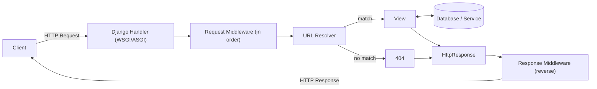
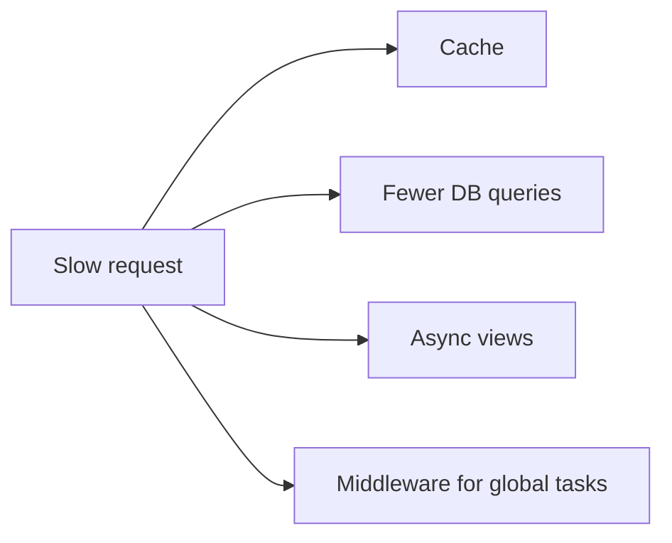

# Day 1: Django Request-Response Lifecycle


> Django receives an HTTP request, runs it through **middleware**, routes it to a **view**, and returns an **HTTP response**.

<!-- Optional: add your infographic as images/day-01.png, then uncomment: -->
<!--  -->

## 1. The flow



## 2. Key concepts

| Concept | Role |
|---|---|
| **HttpRequest** | Incoming data, passed to the view as its first argument |
| **URL Resolver** | Matches the URL to a view (`urls.py`) |
| **View** | Runs the logic and returns a response |
| **Middleware** | Wraps the request before the view and the response after it |
| **HttpResponse** | Outgoing result (`JsonResponse` for APIs) |

| `request.` | Meaning | `response.` | Meaning |
|---|---|---|---|
| `method` | GET, POST... | `status_code` | 200, 404, 500... |
| `path` | Requested path | `content` | The body |
| `GET` / `POST` | Query / form data | `headers` | Response headers |
| `body` | Raw bytes | | |
| `headers` | Request headers | | |
| `FILES` / `COOKIES` | Uploads / cookies | | |

## 3. Middleware

```
Request  ->  M1 -> M2 -> View
Response <-  M1 <- M2 <- View
```

- Order is set by `MIDDLEWARE` in `settings.py`, and **order matters**.
- Middleware can return a response early (e.g. `403`) and skip the view.

```python
class MyMiddleware:
    def __init__(self, get_response):
        self.get_response = get_response

    def __call__(self, request):
        # before the view
        response = self.get_response(request)
        # after the view
        return response
```

## 4. Optimize it



| Tip | How |
|---|---|
| **Cache** | `@cache_page(60 * 15)` on a view (Memcached, Redis...) |
| **Fewer queries** | `select_related()` for foreign keys, `prefetch_related()` for many-to-many |
| **Async views** | `async def` view (Django 3.1+) for I/O work like external API calls |
| **Middleware** | Put global work (security headers, logging) in one place, not in every view |

```python
@cache_page(60 * 15)
def my_view(request): ...

authors = Author.objects.select_related('profile').all()

async def async_view(request):
    await asyncio.sleep(1)
    return JsonResponse({'message': 'Hello'})
```

## 5. Remember

1. `HttpRequest` = in, `HttpResponse` = out.
2. **Middleware runs first, then URL routing**, then the view.
3. Response goes back through middleware in **reverse**.
4. Templates are optional; APIs can return JSON directly.
5. No URL match is a **404**.

**Wrong in the articles:** the dev.to article puts URL routing before middleware, `is_ajax()` was removed in Django 4.0, and a request class does not go in `MIDDLEWARE`.

## Sources

- [DEV Community: Request Lifecycle](https://dev.to/nilebits/django-request-life-cycle-explained-ci6)
- [GeeksforGeeks: Request and Response Cycle](https://www.geeksforgeeks.org/python/django-request-and-response-cycle-httprequest-and-httpresponse-objects/)
- [Django docs: Request and response objects](https://docs.djangoproject.com/en/stable/ref/request-response/)
